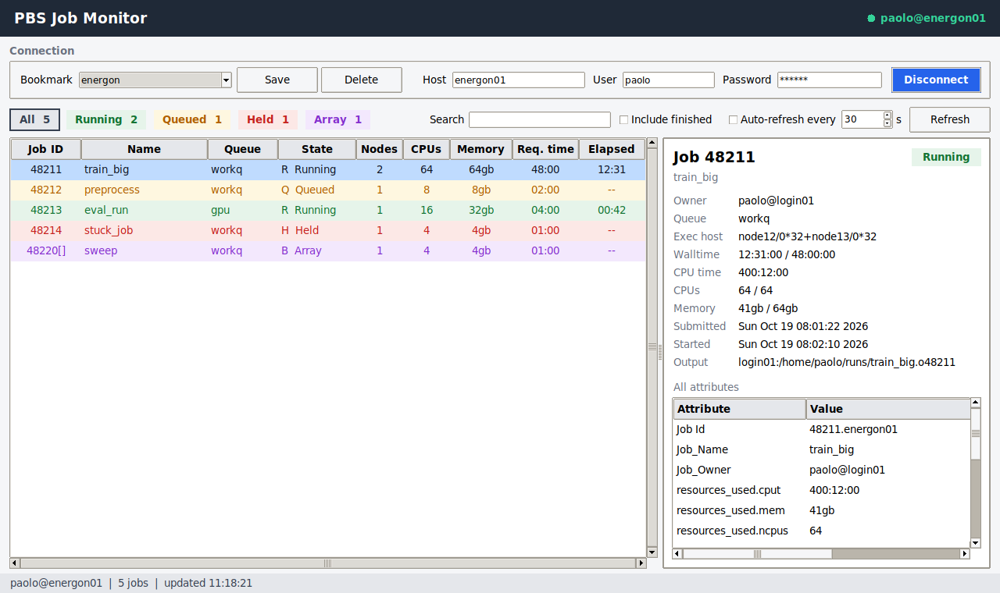

# PBS Job Monitor

A single-window GUI application to monitor PBS (Portable Batch System) jobs over SSH, with encrypted bookmarks for multiple sites.


## Features

- **🪟 Single Window**: Connection bar at the top, job list and job details below
- **★ Bookmarks**: Save multiple sites/logins and switch between them from a dropdown
- **💾 Encrypted Storage**: Bookmarks (including passwords) are encrypted locally with Fernet
- **📊 Job List**: Sortable, color-coded table (ID, name, queue, state, nodes, CPUs, memory, times)
- **🎯 State Counters**: Clickable per-state chips (Running, Queued, Held, …) that filter the list
- **🔍 Search**: Filter by job ID, name or queue
- **📋 Job Details**: Summary (walltime/memory used vs. requested, exec host, output path) plus all `qstat -f` attributes
- **⟳ Refresh**: Manual (button or F5), optional auto-refresh with a configurable interval (5 s to 1 h, default 30 s, remembered between sessions), optional finished jobs (`qstat -x`)

## Screenshot



- **Top**: connection bar with bookmarks
- **Toolbar**: state counters (click to filter), search, finished jobs, auto-refresh and its interval
- **Left**: job list; **right**: details of the selected job. The divider between them can be dragged, and both tables have vertical and horizontal scrollbars

## Requirements

- Python 3.7+ with Tkinter (preferably a Tk build with Xft, see Troubleshooting)
- `cryptography` package for encryption
- `paramiko` package for SSH
- SSH access to PBS server

### Installation

1. **Install dependencies:**
   ```bash
   pip install cryptography paramiko
   ```

2. **Run the application:**
   ```bash
   python pbs_job_monitor.py
   ```

## Usage

1. Fill in **Host**, **User** and **Password** in the connection bar (leave the password empty to use SSH keys / agent)
2. Click **Save** to store them as a bookmark; next time just pick it from the **Bookmark** dropdown
3. Click **Connect** (or press Enter): your jobs appear in the table
4. Click a job to see its details on the right; double-click an attribute to copy its value
5. Click a state chip to filter, a column header to sort, and **Refresh** / F5 to reload

Job IDs are shown without the server suffix (e.g. `1234` instead of `1234.energon01`).

## Color Legend

| State | Color | Description |
|-------|-------|-------------|
| 🟢 R (Running) | Green | Job is running |
| 🟡 Q / W (Queued / Waiting) | Amber | Job is waiting to start |
| 🔴 H (Held) | Red | Job is held |
| 🟣 B (Array) | Purple | Array job with running subjobs |
| 🔵 E (Exiting) | Blue | Job is finishing |
| 🟠 S / U (Suspended) | Orange | Job is suspended |
| ⚫ F / X (Finished) | Gray | Job has finished (with "Include finished") |

## Security Notes

- ✅ Bookmarks are stored encrypted in `~/.pbs_job_monitor.bookmarks`
- ✅ The encryption key is stored separately in `~/.pbs_job_monitor.key` (mode 600)
- ✅ Never share these two files
- ✅ Consider using SSH keys instead of passwords (leave the password empty)

## Project Structure

```
pbs-job-monitor/
├── pbs_job_monitor.py    # Main GUI application
├── README.md              # This documentation
└── screenshot.png         # Screenshot of the main window
```

Bookmarks and the encryption key live in your home directory, not in the project.

## Troubleshooting

### No jobs shown

Make sure:
1. The host is correct and reachable
2. User and password (or SSH key) are valid for the PBS server
3. `qstat -u <user>` works on the frontend; tick **Include finished** to also see completed jobs

### Blocky fonts on Linux

If the text looks pixelated, your Tk was built without Xft and can only use the X11 `fixed` font
(common with conda/miniforge Python). Install an Xft build of Tk:
```bash
conda install -c conda-forge "tk=*=xft_*"
```

### SSH Connection Failed

- Verify you can SSH to the PBS server from your terminal
- Check that `qstat` command is installed on the PBS server
- Ensure network connectivity between your machine and PBS server

### Import Error: cryptography / paramiko

Install the dependencies:
```bash
pip install cryptography paramiko
```

## License

MIT License - Feel free to use and modify as needed.

## Author

Created by pingl for PBS job monitoring tasks

## Contributing

Feel free to:
- Report bugs
- Suggest features (e.g., job submission, cancellation)
- Improve the UI/UX
- Add support for other queue management systems

## Support

For issues or questions:
1. Check the troubleshooting section above
2. Review PBS documentation for your server setup
3. Ensure SSH connectivity to PBS server is working